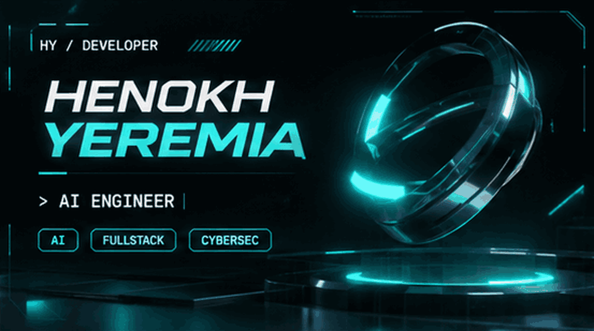
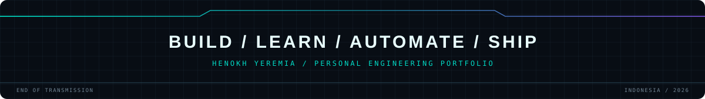

[GitHub](https://github.com/HenokhYeremia)  /  [Instagram](https://www.instagram.com/hnkhyrmiaa_/)  /  [Email](mailto:henokholbrain@gmail.com)

## 01 / PROFILE

I am a software developer interested in building practical digital products, intelligent systems, and automation tools. My work spans full-stack applications, mobile development, data platforms, and experimental AI workflows.

My approach is to learn by building: understand the problem, design the system, implement it, test it, and keep improving it.

**Primary interests:** AI systems, full-stack engineering, application architecture, automation, and software security.

## 02 / SELECTED PROJECTS

<table>
  <tr>
    <td width="50%" valign="top">
      <strong>TURBIFEED</strong> 
      IoT / MOBILE APPLICATION  
      Smart fish-feeding application focused on device monitoring, feeding schedules, manual control, and feeding history.  
      Flutter / Dart / Firebase / Realtime Database
    </td>
    <td width="50%" valign="top">
      <strong>CLC BUSINESS INTELLIGENCE</strong> 
      DATA PLATFORM / DASHBOARD  
      Branch performance monitoring platform built around business intelligence, KPI tracking, data management, and management reporting.  
      Next.js / TypeScript / PostgreSQL / Drizzle ORM / Recharts
    </td>
  </tr>
  <tr>
    <td width="50%" valign="top">
      <strong>LOK4CODE</strong> 
      GAMIFIED EDTECH / SAAS  
      A coding-learning environment based on observing, rewriting, modifying, fixing, building, and remixing real code.  
      Next.js / TypeScript / Tailwind CSS
    </td>
    <td width="50%" valign="top">
      <strong>NOXMODEL / BLENDER AUTO GENERATE</strong> 
      3D TOOLING / AUTOMATION  
      Experimental desktop workflow for turning prompts, images, CAD, or assets into Blender scripts and generated 3D outputs.  
      Python / Blender Python API (bpy) / 3D Workflows
    </td>
  </tr>
</table>

More experiments and repositories are available in the [GitHub repository list](https://github.com/HenokhYeremia?tab=repositories).

## 03 / TECHNOLOGY STACK

**Languages**

  

**Frameworks and application development**

  

**Data, infrastructure, and tools**

  

## 04 / GITHUB ANALYTICS

## 05 / CONTRIBUTION ACTIVITY

## 06 / CONNECT

[GitHub](https://github.com/HenokhYeremia)  /  [Instagram](https://www.instagram.com/hnkhyrmiaa_/)  /  [Email](mailto:henokholbrain@gmail.com)

---

Designed and maintained by Henokh Yeremia. The 3D hero is an animated GIF; the interface graphics are custom SVG assets.
