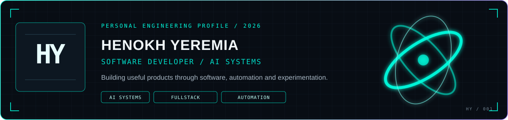
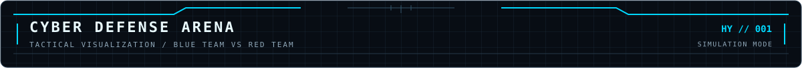
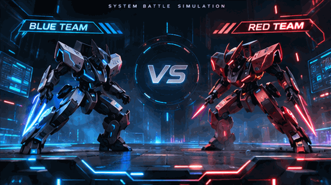
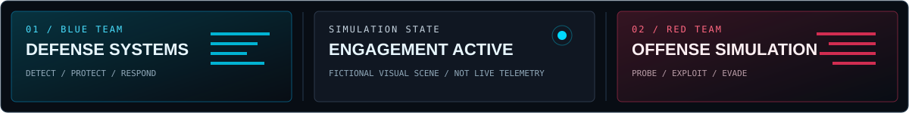
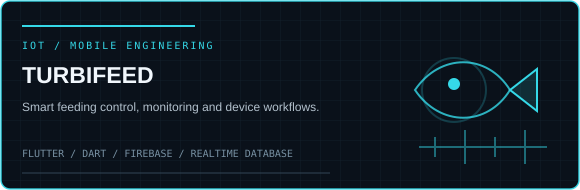
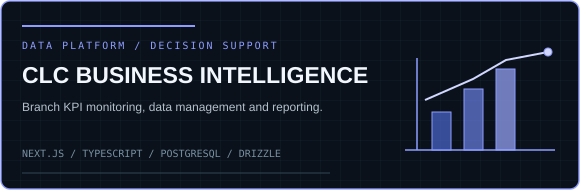
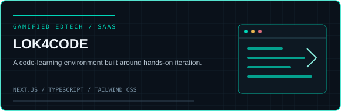
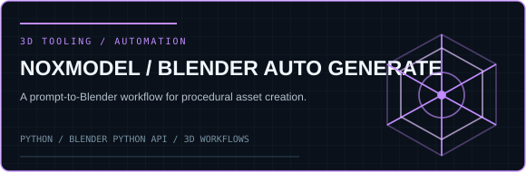
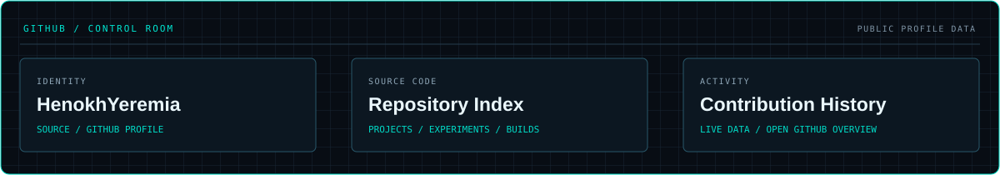
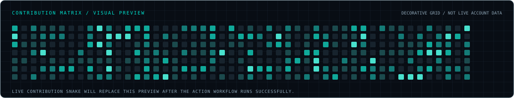

**AI SYSTEMS  /  FULLSTACK ENGINEERING  /  AUTOMATION  /  SOFTWARE SECURITY**

[GitHub](https://github.com/HenokhYeremia)  /  [Instagram](https://www.instagram.com/hnkhyrmiaa_/)  /  [Email](mailto:henokholbrain@gmail.com)

## 01 / PROFILE

I am a software developer interested in building practical digital products, intelligent systems, and automation tools. My work spans full-stack applications, mobile development, data platforms, and experimental AI workflows.

My approach is to learn by building: understand the problem, design the system, implement it, test it, and keep improving it.

**Primary interests:** AI systems, full-stack engineering, application architecture, automation, and software security.

## 02 / CYBER DEFENSE ARENA

A visual tribute to the two sides of security engineering: **Blue Team** focuses on detection, protection, and response; **Red Team** explores attack paths to help expose weaknesses. The scene is fictional artwork, not a live security operation or telemetry feed.

## 03 / SELECTED PROJECTS

<table>
  <tr>
    <td width="50%" valign="top">
      
      Smart fish-feeding control, device monitoring, schedules, manual control, and feeding history.
    </td>
    <td width="50%" valign="top">
      
      Branch KPI monitoring, data management, business intelligence, and management reporting.
    </td>
  </tr>
  <tr>
    <td width="50%" valign="top">
      
      A code-learning environment built around observing, rewriting, modifying, fixing, building, and remixing.
    </td>
    <td width="50%" valign="top">
      
      An experimental prompt-to-Blender workflow for procedural 3D asset generation and automation.
    </td>
  </tr>
</table>

More experiments and repositories are available in the [GitHub repository list](https://github.com/HenokhYeremia?tab=repositories).

## 04 / TECHNOLOGY STACK

**Languages**

  

**Frameworks and application development**

  

**Data, infrastructure, and tools**

  

## 05 / GITHUB CONTROL ROOM

[OPEN PROFILE OVERVIEW](https://github.com/HenokhYeremia?tab=overview)  /  [EXPLORE REPOSITORIES](https://github.com/HenokhYeremia?tab=repositories)

## 06 / CONTRIBUTION ACTIVITY

The contribution snake is generated by GitHub Actions. Run **Generate contribution snake** from the Actions tab once; after the `output` branch is published, replace the preview image above with the live SVG URL shown in `INSTALL.txt`.

## 07 / CONNECT

[GitHub](https://github.com/HenokhYeremia)  /  [Instagram](https://www.instagram.com/hnkhyrmiaa_/)  /  [Email](mailto:henokholbrain@gmail.com)

---

Designed and maintained by Henokh Yeremia. The arena is an animated 3D-style GIF; interface and project panels are custom SVG assets. No live security telemetry is represented.
